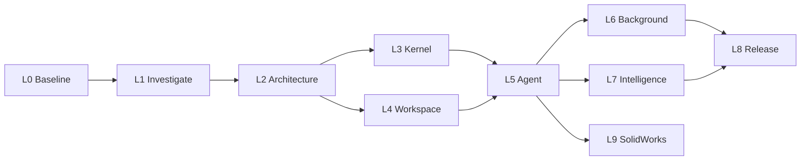

# Loop Graph

The driver prompt `CAD_AGENT_LOOP.md` (installed as `/cad-agent`) reads this file on every tick to decide which loop to work in. `scripts/graph-lint.mjs` runs first inside `npm run gate` and fails when a loop line, a ledger, or the diagram below disagree, or when any citation in these documents stops resolving.

Phases come from `docs/roadmap/MECAGENT_ROADMAP.md` (a frozen copy of the human's input); shared rules are in `docs/LOOP_CONVENTIONS.md`.

## Three nested loops

1. **Graph loop** (this file): picks the active loop.
2. **Task loop** (one ledger task per tick): failing check first, smallest change, focused test, full gate, local commit, journal.
3. **Verification loop** (each ledger's independent-check task): a council of models other than the maker attacks the work, at most 3 rounds of fixes, and a finding counts only as a reproducible failing test or a corrected row.

## Driver rules

1. The active loop is the first unticked loop below whose needs are all ticked.
2. In the active loop's ledger, take the first unticked task whose needs are all ticked and that is not marked (human).
3. If no such task exists in the active loop, try the next unticked loop whose needs are all ticked. If none has an agent task, stop and escalate, naming the (human) tasks that block.
4. Only the human ticks a loop line, after that loop's signoff task is ticked and `npm run gate` passes.
5. A loop's budget is ticks (entries in its Journal) or spend, whichever runs out first. Model API spend for evals counts too; its cap is set in L2 T1. These are defaults, not cost estimates. Edit them here.
6. L9 waits on a licensed SolidWorks install (L9 T0, human). By rule 3 that wait never blocks L6 to L8.

## Loops

- [x] L0 Baseline. ledger: `docs/loops/L0_BASELINE.md` · needs: none. · budget 6 ticks or $8 · `docs/roadmap/MECAGENT_ROADMAP.md#PHASE 0 — ENVIRONMENT AND BASELINE AUDIT`
- [x] L1 Investigate. ledger: `docs/loops/L1_INVESTIGATE.md` · needs: L0. · budget 30 ticks or $40 · `docs/roadmap/MECAGENT_ROADMAP.md#PHASE 1 — MECAGENT PRODUCT INVESTIGATION`
- [x] L2 Architecture. ledger: `docs/loops/L2_ARCHITECTURE.md` · needs: L1. · budget 12 ticks or $15 · `docs/roadmap/MECAGENT_ROADMAP.md#PHASE 2 — TARGET ARCHITECTURE`
- [x] L3 Kernel. ledger: `docs/loops/L3_KERNEL.md` · needs: L2. · budget 20 ticks or $25 · `docs/roadmap/MECAGENT_ROADMAP.md#PHASE 4 — REAL CAD ADAPTER`
- [x] L4 Workspace. ledger: `docs/loops/L4_WORKSPACE.md` · needs: L2. · budget 20 ticks or $25 · `docs/roadmap/MECAGENT_ROADMAP.md#PHASE 3 — PREMIUM CAD DESKTOP EXPERIENCE`
- [x] L5 Agent. ledger: `docs/loops/L5_AGENT.md` · needs: L3, L4. · budget 30 ticks or $40 (25 until the human added 5 on 2026-11-12 for council fixes) · `docs/roadmap/MECAGENT_ROADMAP.md#PHASE 5 — AI CAD AGENT`
- [ ] L6 Background. ledger: `docs/loops/L6_BACKGROUND.md` · needs: L5. · budget 25 ticks or $25 (20 until 2026-11-13, when council round 2's fixes and round 3 needed 5 more under the human's standing approval) · `docs/roadmap/MECAGENT_ROADMAP.md#PHASE 6 — BACKGROUND CAD TASK ENGINE`
- [ ] L7 Intelligence. ledger: `docs/loops/L7_INTELLIGENCE.md` · needs: L5. · budget 25 ticks or $35 · `docs/roadmap/MECAGENT_ROADMAP.md#PHASE 7 — ENGINEERING INTELLIGENCE`
- [ ] L8 Release. ledger: `docs/loops/L8_RELEASE.md` · needs: L6, L7. · budget 15 ticks or $20 · `docs/roadmap/MECAGENT_ROADMAP.md#PHASE 8 — PRODUCTION READINESS`
- [ ] L9 SolidWorks. ledger: `docs/loops/L9_SOLIDWORKS.md` · needs: L5. · budget 15 ticks or $20 · `docs/roadmap/MECAGENT_ROADMAP.md#Milestone 1 Natural language → real CAD model → verified output`

One edge per line below; graph-lint compares these edges with the `needs:` above.

Critical path: L0 → L1 → L2 → L3 → L5 → L7 → L8. Ticks are sequential; branches matter because a loop waiting on a (human) task does not block its sibling (driver rule 3), so L4 work fills L3 waits and L6 fills L7 waits.

Why the kernel comes before SolidWorks: no CAD software is installed here (`docs/loops/L0_BASELINE.md#No CAD software`), and the roadmap's own rule is `docs/roadmap/MECAGENT_ROADMAP.md#If SolidWorks is unavailable, report BLOCKED and implement only the adapter contract and test doubles.` L3 proves geometry on a free headless kernel inside the gate; L9 ports the same adapter contract to SolidWorks once a license exists.
